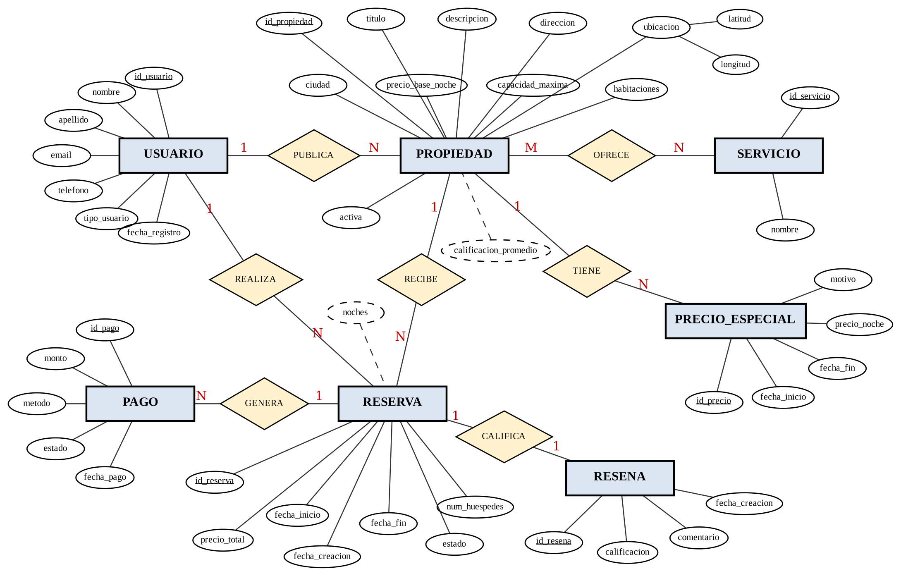
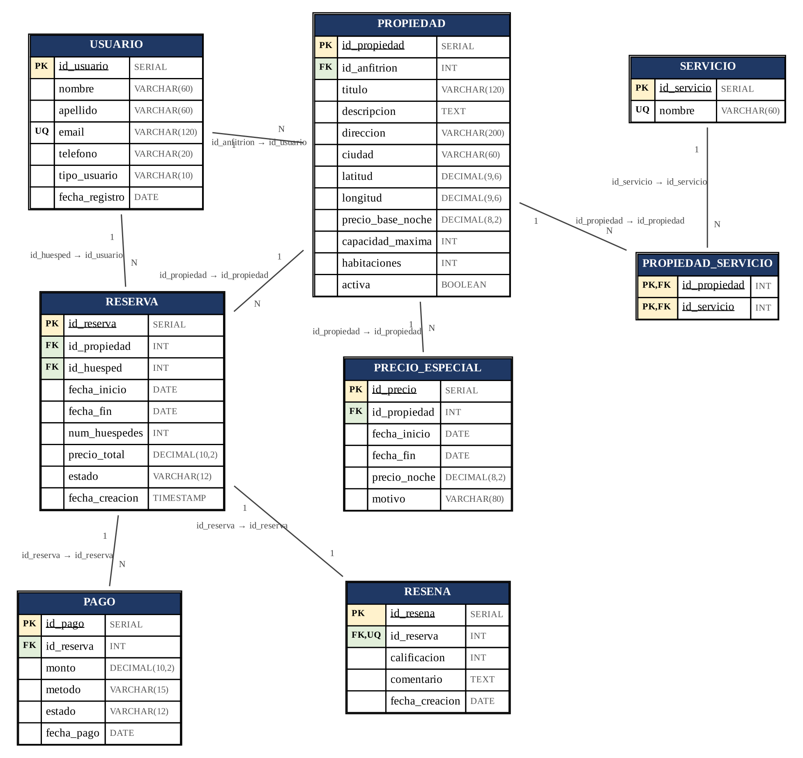

# Sistema de Gestión de Alquiler de Propiedades — Base de Datos

Proyecto final de la unidad 1 de **Base de Datos** (Universidad Nacional de Loja, Carrera de Computación, ciclo 3 A).
Docente: Edwin René Guamán Quinche · Autor: Ricardo Mathias Ochoa Armijos

Base de datos relacional en **PostgreSQL 16** para gestionar propiedades en alquiler temporal (cabañas, departamentos, casas de playa), con reservas **que nunca se solapan**, tarifas por temporada, pagos y reseñas.

## Modelo

8 tablas en 3FN: `USUARIO`, `PROPIEDAD`, `SERVICIO`, `PROPIEDAD_SERVICIO`, `PRECIO_ESPECIAL`, `RESERVA`, `PAGO`, `RESENA`.

| Diagrama Entidad-Relación | Modelo relacional |
|---|---|
|  |  |

## Características destacadas

- **Sin reservas solapadas**: restricción `EXCLUDE USING gist` sobre `daterange(fecha_inicio, fecha_fin, '[)')`, aplicada solo a reservas activas (las canceladas liberan el calendario). Requiere la extensión `btree_gist`.
- **Precios por temporada**: `PRECIO_ESPECIAL` + función `fn_calcular_precio` (suma noche por noche).
- **Trigger `trg_validar_reserva`**: valida capacidad, impide que el anfitrión reserve su propia propiedad y calcula `precio_total`.
- **Vistas de reportes**: `VW_INGRESOS_ANFITRION` y `VW_OCUPACION_2026`.
- **5 consultas** en álgebra relacional → SQL (reunión, diferencia, intersección, división y agrupamiento).

## Estructura del repositorio

```
.
├── sql/
│   ├── 01_ddl.sql                       # Tablas y restricciones
│   ├── 02_funciones_triggers_vistas.sql # Función de precio, trigger, índices, vistas
│   ├── 03_datos.sql                     # Datos de ejemplo (DML)
│   ├── 04_consultas.sql                 # Consultas de álgebra relacional en SQL
│   └── 05_pruebas_integridad.sql        # Pruebas de las reglas de negocio
├── docs/
│   ├── Informe_Fin_Unidad1.docx         # Informe entregado
│   └── diagramas/                       # PNG del E-R y del modelo relacional, más sus fuentes .dot
└── README.md
```

## Cómo ejecutarlo

Requiere PostgreSQL 16 (con la extensión `btree_gist`, incluida en la instalación estándar).

```bash
createdb alquiler_db
psql -d alquiler_db -f sql/01_ddl.sql
psql -d alquiler_db -f sql/02_funciones_triggers_vistas.sql
psql -d alquiler_db -f sql/03_datos.sql
psql -d alquiler_db -f sql/04_consultas.sql
```

Los scripts deben ejecutarse en ese orden (`01` → `02` → `03`).

## Resultados esperados de las consultas

| # | Operador | Resultado |
|---|---|---|
| 1 | ⋈, σ, π, ρ | 4 reservas confirmadas futuras |
| 2 | − | 3 propiedades disponibles (Loja, Montañita, Zamora) |
| 3 | ∩ | Ana Calderón y Valeria Ordóñez |
| 4 | ÷ | Cabaña Vilcabamba, Casa de Playa Montañita, Casa Campestre Zamora |
| 5 | γ | María Torres 645.00 (4.00) · Carlos Andrade 510.00 (4.33) |
