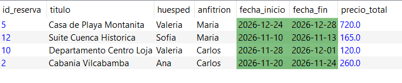
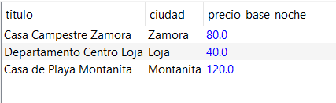
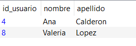
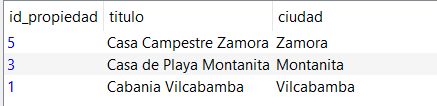
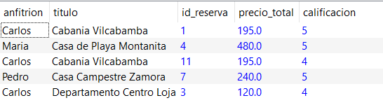

# Consultas en álgebra relacional (versión ejecutable)

Consultas del proyecto escritas en la notación de un intérprete de álgebra relacional: `π` proyección, `σ` selección, `ρ` renombrado, `⋈` reunión natural, `∩` intersección, `-` diferencia y `÷` división. Los nombres de relaciones y atributos coinciden con las tablas del modelo (`usuario`, `propiedad`, `servicio`, `propiedad_servicio`, `reserva`, `resena`).

El texto original está en [`CONSULTAS.txt`](CONSULTAS.txt). Las consultas 1 a 4 coinciden con las del SQL en [`sql/04_consultas.sql`](../sql/04_consultas.sql) y en el [informe](../docs/INFORME.md#-6-consulta-de-álgebra-relacional-y-traducir-a-sql). La consulta 5 de este archivo (reservas completadas con calificación ≥ 4) es distinta de la consulta 5 del informe, que usa agrupamiento (γ).

## Consulta 1 — Reunión natural (⋈), selección (σ), proyección (π) y renombrado (ρ)

Reservas confirmadas posteriores al 7 de noviembre de 2026, con propiedad, huésped, anfitrión, fechas y precio total. `usuario` se usa dos veces, por eso se renombra como huésped y anfitrión.

```text
q1_huesped = ρ id_usuario➡id_huesped, nombre➡huesped (π id_usuario, nombre (usuario))
q1_anfitrion = ρ id_usuario➡id_anfitrion, nombre➡anfitrion (π id_usuario, nombre (usuario))
q1_prop = π id_propiedad, id_anfitrion, titulo (propiedad)
q1_futuras = σ (estado == 'CONFIRMADA' and str(fecha_inicio) > '2026-11-07') (reserva)
consulta1 = π id_reserva, titulo, huesped, anfitrion, fecha_inicio, fecha_fin, precio_total (q1_futuras ⋈ q1_prop ⋈ q1_huesped ⋈ q1_anfitrion)
```

<div align="center">



***Figura 1. Resultado de la consulta 1.***

</div>

## Consulta 2 — Diferencia (−)

Propiedades con capacidad para al menos 4 personas que no tienen reservas pendientes o confirmadas que se solapen con el rango del 20 al 23 de noviembre de 2026.

```text
q2_r1 = π id_propiedad (σ capacidad_maxima >= 4 (propiedad))
q2_r2 = π id_propiedad (σ ((estado == 'PENDIENTE' or estado == 'CONFIRMADA') and str(fecha_inicio) < '2026-11-23' and str(fecha_fin) > '2026-11-20') (reserva))
consulta2 = π titulo, ciudad, precio_base_noche (propiedad ⋈ (q2_r1 - q2_r2))
```

<div align="center">



***Figura 2. Resultado de la consulta 2.***

</div>

## Consulta 3 — Intersección (∩)

Huéspedes que reservaron (sin cancelar) tanto con el anfitrión 1 como con el anfitrión 2.

```text
q3_rp = reserva ⋈ π id_propiedad, id_anfitrion (propiedad)
q3_g1 = π id_huesped (σ id_anfitrion == 1 and estado != 'CANCELADA' (q3_rp))
q3_g2 = π id_huesped (σ id_anfitrion == 2 and estado != 'CANCELADA' (q3_rp))
consulta3 = π id_usuario, nombre, apellido (usuario ⋈ ρ id_huesped➡id_usuario (q3_g1 ∩ q3_g2))
```

<div align="center">



***Figura 3. Resultado de la consulta 3.***

</div>

## Consulta 4 — División (÷)

Propiedades que ofrecen todos los servicios requeridos: WiFi, Piscina y Estacionamiento.

```text
q4_s = π id_servicio (σ (nombre == 'WiFi' or nombre == 'Piscina' or nombre == 'Estacionamiento') (servicio))
consulta4 = π id_propiedad, titulo, ciudad (propiedad ⋈ (propiedad_servicio ÷ q4_s))
```

<div align="center">



***Figura 4. Resultado de la consulta 4.***

</div>

## Consulta 5 — Reunión de cuatro relaciones y selección

Reservas completadas con calificación de 4 o más, mostrando anfitrión, propiedad, precio total y calificación.

```text
q5_anfitrion = ρ id_usuario➡id_anfitrion, nombre➡anfitrion (π id_usuario, nombre (usuario))
q5_prop = π id_propiedad, id_anfitrion, titulo (propiedad)
q5_comp = σ estado == 'COMPLETADA' (reserva)
q5_cal = σ calificacion >= 4 (π id_reserva, calificacion (resena))
consulta5 = π anfitrion, titulo, id_reserva, precio_total, calificacion (q5_comp ⋈ q5_cal ⋈ q5_prop ⋈ q5_anfitrion)
```

<div align="center">



***Figura 5. Resultado de la consulta 5.***

</div>
