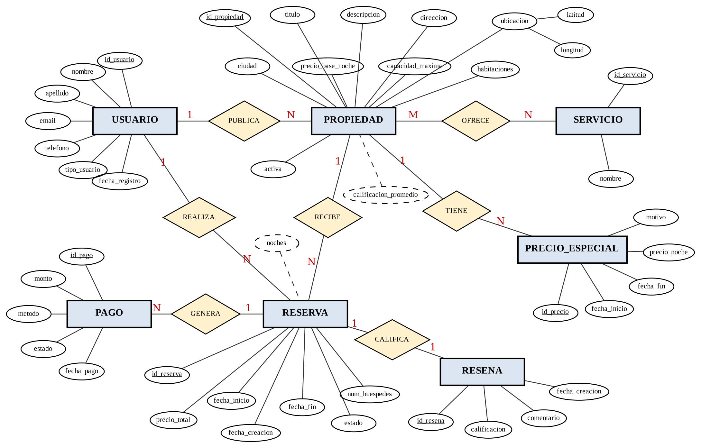
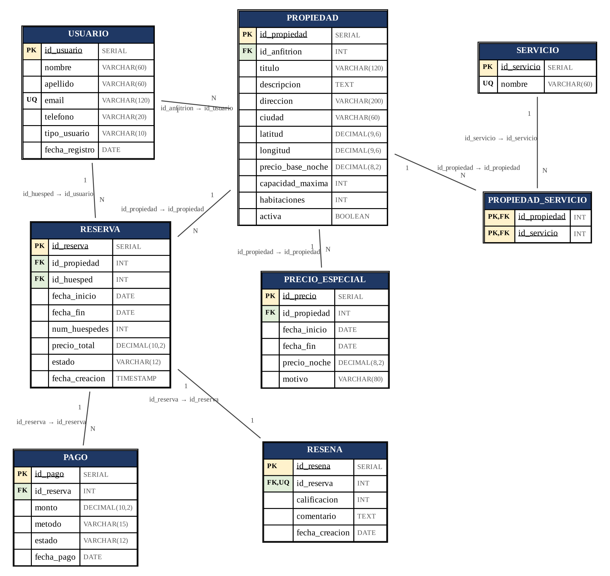
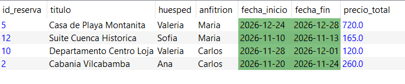
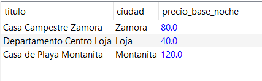
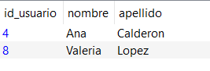
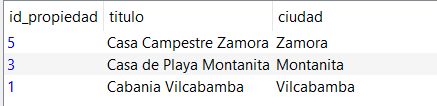
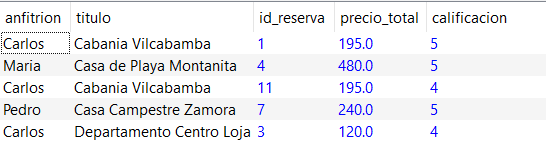

<div align="center">

# 🏠 INFORME DE FIN DE UNIDAD

**FEIRNNR - Carrera de Computación**


</div>

---

## 👤 Datos Generales

| | |
| :--- | :--- |
| 📘 **Asignatura** | Base de datos |
| 🎓 **Ciclo** | 3 A |
| 🔢 **Unidad** | 1 |
| 🎯 **Resultado de aprendizaje de la unidad** | Modela bases de datos de problemas reales, bajo los principios de solidaridad, transparencia, responsabilidad y honestidad. |
| 👨‍🏫 **Nombre del Docente** | Edwin René Guamán Quinche |
| 📅 **Fecha** | 10/11/2026 |
| 🔗 **Enlace de Git** | [16-01-2005/Proyecto-Final-de-Base-de-Datos](https://github.com/16-01-2005/Proyecto-Final-de-Base-de-Datos) |
| 🧑‍🎓 **Nombres y apellidos del estudiante** | Ricardo Mathias Ochoa Armijos |


---

## 📌 1. TITULO

Diseño e implementación de una base de datos relacional para la Gestión de Alquiler de Propiedades: control de reservas sin solapamiento de fechas, tarifas por temporada, pagos y reseñas.


---

## 📋 2. CONTEXTO DEL PROBLEMA

El alquiler temporal de viviendas (cabañas, departamentos, casas de playa y suites) es una actividad en crecimiento en ciudades y destinos turísticos del Ecuador como Loja, Vilcabamba, Cuenca, Zamora y Montañita. En este entorno, anfitriones (propietarios) y huéspedes (viajeros) se contactan con frecuencia por mensajería instantánea y registran las reservas en cuadernos u hojas de cálculo, sin un sistema que centralice la información.

Sin una base de datos, las principales dificultades son: (a) reservas dobles o solapadas, porque no existe un control automático del calendario de cada propiedad; (b) tarifas inconsistentes, ya que los precios de fines de semana, feriados y fiestas se calculan a mano; (c) falta de trazabilidad de los pagos y reembolsos; (d) reseñas sin verificar, que no garantizan que quien califica realmente se hospedó; y (e) imposibilidad de obtener reportes confiables de ingresos y ocupación.

El problema afecta a los anfitriones, que pierden ingresos o reputación cuando deben cancelar una reserva por un error de agenda; a los huéspedes, que pierden dinero y tiempo si la propiedad ya estaba ocupada; y a la organización que administra la plataforma, que no puede auditar sus operaciones.

Se necesita gestionar correctamente los datos de usuarios (anfitriones y huéspedes), propiedades y su ubicación, servicios ofrecidos (WiFi, piscina, estacionamiento, etc.), reservas con sus fechas y estados, tarifas especiales por temporada, pagos y reseñas. Hacerlo de forma íntegra es importante porque el núcleo del negocio es la confianza: el calendario no puede tener contradicciones, los montos deben ser transparentes y las calificaciones deben ser honestas y comprobables, en línea con los principios de transparencia, responsabilidad y honestidad de la asignatura.


---

## 🎯 3. OBJETIVOS

### 🏁 3.1. Objetivo General

Diseñar e implementar una base de datos relacional en PostgreSQL, a partir de los modelos Entidad-Relación y relacional, para optimizar la gestión de propiedades, reservas, pagos y reseñas de un sistema de alquiler temporal, garantizando la integridad del calendario mediante restricciones de exclusión que impidan reservas solapadas.

### 📍 3.2. Objetivos Específicos

- Elaborar el diagrama Entidad-Relación y derivar el modelo relacional normalizado (tercera forma normal) del sistema, identificando entidades, atributos, cardinalidades y claves primarias y foráneas de las ocho tablas que lo componen.

- Construir el esquema físico en PostgreSQL (DDL, DML, restricciones, disparador, funciones y vistas) e implementar cinco consultas formuladas en álgebra relacional y traducidas a SQL, que respondan a necesidades reales del negocio como disponibilidad de propiedades, ingresos por anfitrión y servicios ofrecidos.


---

## 🧬 4. MODELOS CONCEPTUALES DE BASES DE DATOS

### 🔷 4.1. Modelo Entidad-Relación (E-R)

El diagrama E-R (Figura 1) sigue la notación de Chen [3]: las entidades se representan con rectángulos, los atributos con elipses, las relaciones con rombos y las cardinalidades se indican junto a cada línea. Los identificadores (llaves primarias) están subrayados. Se identificaron siete entidades: USUARIO, PROPIEDAD, SERVICIO, RESERVA, PRECIO_ESPECIAL, PAGO y RESENA. La entidad asociativa PROPIEDAD_SERVICIO aparece solo en el modelo relacional, pues resuelve la relación M:N entre PROPIEDAD y SERVICIO.

Tipos de atributos presentes en el modelo: atributos simples (la mayoría); un atributo compuesto, ubicacion (latitud, longitud), en PROPIEDAD; y dos atributos derivados, dibujados con línea discontinua, que no se almacenan: calificacion_promedio (se calcula a partir de las reseñas) y noches (fecha_fin − fecha_inicio). No existen atributos multivaluados porque los servicios de una propiedad se modelaron como una entidad independiente.

Relaciones y cardinalidades:

| Relación | Entidades | Cardinalidad | Descripción |
|:---|:---|:---|:---|
| PUBLICA | USUARIO – PROPIEDAD | 1:N | Un anfitrión publica varias propiedades; cada una tiene un solo anfitrión. |
| REALIZA | USUARIO – RESERVA | 1:N | Un huésped realiza varias reservas. |
| RECIBE | PROPIEDAD – RESERVA | 1:N | Una propiedad recibe muchas reservas, sin solaparse en fechas. |
| OFRECE | PROPIEDAD – SERVICIO | M:N | Se resuelve con la tabla PROPIEDAD_SERVICIO. |
| TIENE | PROPIEDAD – PRECIO_ESPECIAL | 1:N | Una propiedad puede tener varias tarifas por temporada. |
| GENERA | RESERVA – PAGO | 1:N | Una reserva genera uno o más pagos (o un reembolso). |
| CALIFICA | RESERVA – RESENA | 1:1 | Cada reserva admite como máximo una reseña. |

<div align="center">



***Figura 1. Diagrama Entidad-Relación del sistema de Gestión de Alquiler de Propiedades.***

</div>

### 🔶 4.2. Modelo Relacional

El modelo relacional se derivó del diagrama E-R con las reglas habituales de transformación: cada entidad se convierte en una tabla; las relaciones 1:N se implementan con una clave foránea en el lado “muchos”; la relación M:N entre PROPIEDAD y SERVICIO se resuelve con la tabla asociativa PROPIEDAD_SERVICIO, cuya clave primaria es compuesta; y la relación 1:1 entre RESERVA y RESENA se implementa con una clave foránea con restricción UNIQUE. Los atributos derivados no se almacenan y el atributo compuesto ubicacion se descompone en latitud y longitud. El resultado cumple la tercera forma normal [2].

| Tabla | Clave primaria (PK) | Claves foráneas (FK) y restricciones únicas (UQ) |
|:---|:---|:---|
| USUARIO | id_usuario | UQ: email |
| PROPIEDAD | id_propiedad | FK: id_anfitrion → USUARIO(id_usuario) |
| SERVICIO | id_servicio | UQ: nombre |
| PROPIEDAD_SERVICIO | (id_propiedad, id_servicio) | FK: id_propiedad → PROPIEDAD; id_servicio → SERVICIO |
| PRECIO_ESPECIAL | id_precio | FK: id_propiedad → PROPIEDAD |
| RESERVA | id_reserva | FK: id_propiedad → PROPIEDAD; id_huesped → USUARIO(id_usuario) |
| PAGO | id_pago | FK: id_reserva → RESERVA |
| RESENA | id_resena | FK y UQ: id_reserva → RESERVA |

La Figura 2 muestra el diagrama relacional con los tipos de datos sugeridos (PK en amarillo, FK en verde, UQ = valor único). Cada línea indica la clave foránea y su cardinalidad (N en la tabla que contiene la FK y 1 en la tabla referenciada).

<div align="center">



***Figura 2. Modelo relacional del sistema de Gestión de Alquiler de Propiedades (elaborado con draw.io).***

</div>


---

## 💻 5. CÓDIGO SQL

El esquema se implementó en PostgreSQL 16 y todo el código de este informe fue ejecutado y verificado en ese motor. Se usó la convención de nombres de tablas en MAYÚSCULAS, columnas en minúsculas con guion bajo y llaves primarias con el prefijo id_. Se eligió PostgreSQL porque su restricción EXCLUDE permite garantizar la ausencia de reservas solapadas directamente en el motor [1].

### 🏗️ 5.1. Creación de Tablas (DDL)

A continuación se presenta la creación de las ocho tablas del sistema, con restricciones PRIMARY KEY, NOT NULL, UNIQUE, DEFAULT, CHECK y FOREIGN KEY. Las dos restricciones EXCLUDE son el núcleo del diseño: en RESERVA impiden que una misma propiedad tenga dos reservas activas (PENDIENTE, CONFIRMADA o COMPLETADA) con rangos de fechas que se crucen; las reservas CANCELADAS no bloquean el calendario. El rango se define como [inicio, fin), de modo que un huésped puede salir el mismo día en que otro entra.

```sql
CREATE EXTENSION IF NOT EXISTS btree_gist;
CREATE TABLE USUARIO (
    id_usuario     SERIAL       PRIMARY KEY,
    nombre         VARCHAR(60)  NOT NULL,
    apellido       VARCHAR(60)  NOT NULL,
    email          VARCHAR(120) NOT NULL UNIQUE,
    telefono       VARCHAR(20),
    tipo_usuario   VARCHAR(10)  NOT NULL DEFAULT 'HUESPED'
                   CHECK (tipo_usuario IN ('ANFITRION', 'HUESPED', 'AMBOS')),
    fecha_registro DATE         NOT NULL DEFAULT CURRENT_DATE
);
CREATE TABLE PROPIEDAD (
    id_propiedad      SERIAL        PRIMARY KEY,
    id_anfitrion      INT           NOT NULL REFERENCES USUARIO(id_usuario),
    titulo            VARCHAR(120)  NOT NULL,
    descripcion       TEXT,
    direccion         VARCHAR(200)  NOT NULL,
    ciudad            VARCHAR(60)   NOT NULL,
    latitud           DECIMAL(9,6),
    longitud          DECIMAL(9,6),
    precio_base_noche DECIMAL(8,2)  NOT NULL CHECK (precio_base_noche > 0),
    capacidad_maxima  INT           NOT NULL CHECK (capacidad_maxima > 0),
    habitaciones      INT           NOT NULL CHECK (habitaciones >= 1),
    activa            BOOLEAN       NOT NULL DEFAULT TRUE
);
CREATE TABLE SERVICIO (
    id_servicio SERIAL      PRIMARY KEY,
    nombre      VARCHAR(60) NOT NULL UNIQUE
);
CREATE TABLE PROPIEDAD_SERVICIO (
    id_propiedad INT NOT NULL REFERENCES PROPIEDAD(id_propiedad) ON DELETE CASCADE,
    id_servicio  INT NOT NULL REFERENCES SERVICIO(id_servicio),
    PRIMARY KEY (id_propiedad, id_servicio)
);
CREATE TABLE PRECIO_ESPECIAL (
    id_precio    SERIAL        PRIMARY KEY,
    id_propiedad INT           NOT NULL REFERENCES PROPIEDAD(id_propiedad) ON DELETE CASCADE,
    fecha_inicio DATE          NOT NULL,
    fecha_fin    DATE          NOT NULL,
    precio_noche DECIMAL(8,2)  NOT NULL CHECK (precio_noche > 0),
    motivo       VARCHAR(80)   NOT NULL,
    CHECK (fecha_fin >= fecha_inicio),
    -- una propiedad no puede tener dos tarifas especiales que se crucen
    EXCLUDE USING gist (
        id_propiedad WITH =,
        daterange(fecha_inicio, fecha_fin, '[]') WITH &&
    )
);
CREATE TABLE RESERVA (
    id_reserva      SERIAL        PRIMARY KEY,
    id_propiedad    INT           NOT NULL REFERENCES PROPIEDAD(id_propiedad),
    id_huesped      INT           NOT NULL REFERENCES USUARIO(id_usuario),
    fecha_inicio    DATE          NOT NULL,
    fecha_fin       DATE          NOT NULL,
    num_huespedes   INT           NOT NULL CHECK (num_huespedes > 0),
    precio_total    DECIMAL(10,2) NOT NULL DEFAULT 0 CHECK (precio_total >= 0),
    estado          VARCHAR(12)   NOT NULL DEFAULT 'PENDIENTE'
                    CHECK (estado IN ('PENDIENTE','CONFIRMADA','CANCELADA','COMPLETADA')),
    fecha_creacion  TIMESTAMP     NOT NULL DEFAULT NOW(),
    CHECK (fecha_fin > fecha_inicio),
    -- Garantía estricta: ninguna propiedad con dos reservas activas que se solapen
    EXCLUDE USING gist (
        id_propiedad WITH =,
        daterange(fecha_inicio, fecha_fin, '[)') WITH &&
    ) WHERE (estado IN ('PENDIENTE', 'CONFIRMADA', 'COMPLETADA'))
);
CREATE TABLE PAGO (
    id_pago     SERIAL        PRIMARY KEY,
    id_reserva  INT           NOT NULL REFERENCES RESERVA(id_reserva),
    monto       DECIMAL(10,2) NOT NULL CHECK (monto > 0),
    metodo      VARCHAR(15)   NOT NULL CHECK (metodo IN ('TARJETA','TRANSFERENCIA','EFECTIVO')),
    estado      VARCHAR(12)   NOT NULL DEFAULT 'PAGADO'
                CHECK (estado IN ('PAGADO','REEMBOLSADO')),
    fecha_pago  DATE          NOT NULL DEFAULT CURRENT_DATE
);
CREATE TABLE RESENA (
    id_resena      SERIAL    PRIMARY KEY,
    id_reserva     INT       NOT NULL UNIQUE REFERENCES RESERVA(id_reserva),
    calificacion   INT       NOT NULL CHECK (calificacion BETWEEN 1 AND 5),
    comentario     TEXT,
    fecha_creacion DATE      NOT NULL DEFAULT CURRENT_DATE
);
```

### 📥 5.2. Inserción de Datos (DML)

Se insertaron datos de ejemplo coherentes entre sí (8 usuarios, 6 propiedades, 6 servicios, 23 asignaciones de servicios, 5 tarifas especiales, 12 reservas, 11 pagos y 6 reseñas). El orden respeta las claves foráneas, y PRECIO_ESPECIAL se carga antes que RESERVA porque el disparador de la sección 5.3 usa esas tarifas para calcular el precio. Los datos incluyen casos variados: reservas pendientes, confirmadas, completadas y una cancelada que coincide en fechas con otra reserva de la misma propiedad (permitido por la condición WHERE de la restricción).

```sql
INSERT INTO USUARIO (nombre, apellido, email, telefono, tipo_usuario, fecha_registro) VALUES
('Carlos',  'Andrade',  'carlos.andrade@example.com',  '0991111111', 'ANFITRION', '2025-03-10'),
('María',   'Torres',   'maria.torres@example.com',    '0992222222', 'ANFITRION', '2025-04-02'),
('Luis',    'Pérez',    'luis.perez@example.com',      '0983333333', 'HUESPED',   '2025-06-15'),
('Ana',     'Calderón', 'ana.calderon@example.com',    '0984444444', 'HUESPED',   '2025-07-21'),
('Diego',   'Romero',   'diego.romero@example.com',    '0995555555', 'AMBOS',     '2025-08-05'),
('Sofía',   'Jaramillo','sofia.jaramillo@example.com', '0986666666', 'HUESPED',   '2025-09-30'),
('Pedro',   'Valarezo', 'pedro.valarezo@example.com',  '0997777777', 'ANFITRION', '2026-01-12'),
('Valeria', 'Ordóñez',  'valeria.ordonez@example.com', '0988888888', 'HUESPED',   '2026-02-18');
INSERT INTO SERVICIO (nombre) VALUES
('WiFi'), ('Piscina'), ('Aire acondicionado'), ('Estacionamiento'),
('Cocina equipada'), ('Mascotas permitidas');
INSERT INTO PROPIEDAD (id_anfitrion, titulo, descripcion, direccion, ciudad, latitud, longitud,
                       precio_base_noche, capacidad_maxima, habitaciones) VALUES
(1, 'Cabaña Vilcabamba',          'Cabaña rodeada de montañas',       'Vía a Yamburara km 2',
    'Vilcabamba', -4.261500, -79.222000,  65.00, 6, 3),
(1, 'Departamento Centro Loja',   'Departamento céntrico y moderno',  'Bolívar y Mercadillo',
    'Loja',       -3.993100, -79.204200,  40.00, 4, 2),
(2, 'Casa de Playa Montañita',    'Casa frente al mar con piscina',   'Av. Principal s/n',
    'Montañita',  -1.826400, -80.752500, 120.00, 8, 4),
(2, 'Suite Cuenca Histórica',     'Suite en el centro histórico',     'Calle Larga 5-24',
    'Cuenca',     -2.897400, -79.004500,  55.00, 2, 1),
(7, 'Casa Campestre Zamora',      'Casa con jardín y río cercano',    'Vía a Yacuambi km 4',
    'Zamora',     -4.069200, -78.956700,  80.00, 5, 3),
(5, 'Loft La Floresta',           'Loft artístico para viajeros',     'Calle Galavis y Toledo',
    'Quito',      -0.200000, -78.490000,  70.00, 3, 1);
INSERT INTO PROPIEDAD_SERVICIO (id_propiedad, id_servicio) VALUES
(1,1),(1,2),(1,4),(1,5),(1,6),
(2,1),(2,3),(2,5),
(3,1),(3,2),(3,3),(3,4),
(4,1),(4,3),(4,5),
(5,1),(5,2),(5,4),(5,5),(5,6),
(6,1),(6,3),(6,5);
INSERT INTO PRECIO_ESPECIAL (id_propiedad, fecha_inicio, fecha_fin, precio_noche, motivo) VALUES
(3, '2026-12-20', '2027-01-06', 180.00, 'Fiestas de fin de año'),
(3, '2027-02-13', '2027-02-17', 160.00, 'Carnaval'),
(1, '2026-12-24', '2026-12-28',  85.00, 'Navidad'),
(4, '2026-11-01', '2026-11-04',  75.00, 'Feriado de noviembre'),
(5, '2026-12-26', '2027-01-02', 110.00, 'Fin de año');
INSERT INTO RESERVA (id_propiedad, id_huesped, fecha_inicio, fecha_fin, num_huespedes,
    precio_total, estado) VALUES
(1, 3, '2026-10-10', '2026-10-13', 3, 195.00, 'COMPLETADA'),
(1, 4, '2026-11-20', '2026-11-24', 4, 260.00, 'CONFIRMADA'),
(2, 3, '2026-09-01', '2026-09-04', 2, 120.00, 'COMPLETADA'),
(3, 6, '2026-08-14', '2026-08-18', 5, 480.00, 'COMPLETADA'),
(3, 8, '2026-12-24', '2026-12-28', 6, 720.00, 'CONFIRMADA'),
(4, 4, '2026-10-02', '2026-10-05', 2, 165.00, 'COMPLETADA'),
(5, 5, '2026-10-17', '2026-10-20', 4, 240.00, 'COMPLETADA'),
(5, 6, '2026-10-18', '2026-10-21', 3, 240.00, 'CANCELADA'),
(6, 3, '2026-11-14', '2026-11-16', 2, 140.00, 'PENDIENTE'),
(2, 8, '2026-11-28', '2026-12-01', 3, 120.00, 'CONFIRMADA'),
(1, 8, '2026-08-05', '2026-08-08', 2, 195.00, 'COMPLETADA'),
(4, 6, '2026-11-10', '2026-11-13', 2, 165.00, 'CONFIRMADA');
INSERT INTO PAGO (id_reserva, monto, metodo, estado, fecha_pago) VALUES
(1, 195.00, 'TARJETA',       'PAGADO',      '2026-10-01'),
(2, 260.00, 'TRANSFERENCIA', 'PAGADO',      '2026-11-01'),
(3, 120.00, 'EFECTIVO',      'PAGADO',      '2026-08-28'),
(4, 480.00, 'TARJETA',       'PAGADO',      '2026-08-01'),
(5, 720.00, 'TARJETA',       'PAGADO',      '2026-11-02'),
(6, 165.00, 'TRANSFERENCIA', 'PAGADO',      '2026-09-25'),
(7, 240.00, 'TARJETA',       'PAGADO',      '2026-10-10'),
(8, 240.00, 'TARJETA',       'REEMBOLSADO', '2026-10-12'),
(10,120.00, 'TRANSFERENCIA', 'PAGADO',      '2026-11-03'),
(11,195.00, 'EFECTIVO',      'PAGADO',      '2026-07-30'),
(12,165.00, 'TARJETA',       'PAGADO',      '2026-11-05');
INSERT INTO RESENA (id_reserva, calificacion, comentario, fecha_creacion) VALUES
(1,  5, 'Excelente cabaña, muy tranquila y limpia.',        '2026-10-14'),
(3,  4, 'Muy buena ubicación en el centro de Loja.',        '2026-09-05'),
(4,  5, 'La casa de playa superó nuestras expectativas.',   '2026-08-19'),
(6,  3, 'Bonita suite, pero algo ruidosa por la noche.',    '2026-10-06'),
(7,  5, 'Lugar ideal para descansar en familia.',           '2026-10-21'),
(11, 4, 'Buena atención del anfitrión y vista increíble.',  '2026-08-09');
```

### ✨ 5.3. Mejoras al modelo base: reglas de negocio, vistas e índices

Sobre el modelo básico (usuarios, propiedades, servicios, reservas y reseñas) se agregaron las siguientes mejoras:

- Restricción de exclusión corregida: la propuesta básica usa EXCLUDE sobre todas las filas, lo que impediría volver a reservar fechas liberadas por una cancelación. Aquí la restricción solo aplica a reservas activas.

- Precios por temporada: la tabla PRECIO_ESPECIAL guarda tarifas de feriados y fiestas (con su propia restricción EXCLUDE para que no se crucen) y la función fn_calcular_precio suma noche por noche usando la tarifa especial si existe o la tarifa base en caso contrario.

- Validaciones con disparador: el trigger trg_validar_reserva rechaza reservas que superan la capacidad máxima o en las que el anfitrión reserva su propia propiedad, y calcula automáticamente el precio_total.

- Pagos: la tabla PAGO registra método, estado y reembolsos de cada reserva; además se añadió el estado COMPLETADA en RESERVA, necesario para permitir reseñas solo de estancias realizadas.

- Reportes: las vistas VW_INGRESOS_ANFITRION (ingresos mensuales por anfitrión) y VW_OCUPACION_2026 (noches reservadas y porcentaje de ocupación por propiedad) responden a consultas frecuentes sin repetir código.

- Rendimiento y ubicación: índices sobre ciudad y huésped, y coordenadas (latitud, longitud) para una futura búsqueda geográfica con PostGIS.

```sql
-- Precio total = suma de cada noche (tarifa especial si existe, si no la tarifa base)
CREATE OR REPLACE FUNCTION fn_calcular_precio(p_propiedad INT, p_inicio DATE, p_fin DATE)
RETURNS DECIMAL(10,2) AS $$
    SELECT COALESCE(SUM(COALESCE(
               (SELECT pe.precio_noche
                  FROM PRECIO_ESPECIAL pe
                 WHERE pe.id_propiedad = p.id_propiedad
                   AND d::date BETWEEN pe.fecha_inicio AND pe.fecha_fin),
               p.precio_base_noche)), 0)
      FROM PROPIEDAD p,
           generate_series(p_inicio, p_fin - 1, INTERVAL '1 day') AS d
     WHERE p.id_propiedad = p_propiedad;
$$ LANGUAGE SQL STABLE;
-- Reglas de negocio de una reserva (se ejecuta antes de INSERT/UPDATE)
CREATE OR REPLACE FUNCTION fn_validar_reserva() RETURNS TRIGGER AS $$
DECLARE
    v_capacidad INT;
    v_anfitrion INT;
BEGIN
    SELECT capacidad_maxima, id_anfitrion INTO v_capacidad, v_anfitrion
      FROM PROPIEDAD WHERE id_propiedad = NEW.id_propiedad;
    IF NEW.num_huespedes > v_capacidad THEN
        RAISE EXCEPTION 'La propiedad admite máximo % huéspedes', v_capacidad;
    END IF;
    IF NEW.id_huesped = v_anfitrion THEN
        RAISE EXCEPTION 'El anfitrión no puede reservar su propia propiedad';
    END IF;
    NEW.precio_total := fn_calcular_precio(NEW.id_propiedad, NEW.fecha_inicio, NEW.fecha_fin);
    RETURN NEW;
END;
$$ LANGUAGE plpgsql;
CREATE TRIGGER trg_validar_reserva
BEFORE INSERT OR UPDATE ON RESERVA
FOR EACH ROW EXECUTE FUNCTION fn_validar_reserva();
-- Índices para búsquedas frecuentes
CREATE INDEX idx_propiedad_ciudad   ON PROPIEDAD (ciudad);
CREATE INDEX idx_reserva_huesped    ON RESERVA (id_huesped);
-- Vista de ingresos mensuales por anfitrión
CREATE VIEW VW_INGRESOS_ANFITRION AS
SELECT u.id_usuario AS id_anfitrion,
       u.nombre || ' ' || u.apellido AS anfitrion,
       DATE_TRUNC('month', r.fecha_inicio)::date AS mes,
       COUNT(*)            AS reservas,
       SUM(r.precio_total) AS ingresos
  FROM USUARIO u
  JOIN PROPIEDAD p ON p.id_anfitrion = u.id_usuario
  JOIN RESERVA   r ON r.id_propiedad = p.id_propiedad
 WHERE r.estado IN ('CONFIRMADA', 'COMPLETADA')
 GROUP BY u.id_usuario, u.nombre, u.apellido, DATE_TRUNC('month', r.fecha_inicio);
-- Vista de tasa de ocupación (noches reservadas del año 2026 / 365)
CREATE VIEW VW_OCUPACION_2026 AS
SELECT p.id_propiedad, p.titulo,
       COALESCE(SUM(r.fecha_fin - r.fecha_inicio), 0) AS noches_reservadas,
       ROUND(COALESCE(SUM(r.fecha_fin - r.fecha_inicio), 0) * 100.0 / 365, 2) AS ocupacion_pct
  FROM PROPIEDAD p
  LEFT JOIN RESERVA r ON r.id_propiedad = p.id_propiedad
       AND r.estado IN ('CONFIRMADA', 'COMPLETADA')
       AND r.fecha_inicio >= DATE '2026-01-01' AND r.fecha_fin <= DATE '2026-12-31'
 GROUP BY p.id_propiedad, p.titulo;
```

Pruebas de integridad (resultados reales obtenidos en PostgreSQL 16):

Intento de reservar la Cabaña Vilcabamba del 22 al 26 de noviembre de 2026, fechas que se cruzan con la reserva 2 (20 al 24 de noviembre):

```sql
INSERT INTO RESERVA (id_propiedad, id_huesped, fecha_inicio, fecha_fin, num_huespedes)
VALUES (1, 3, '2026-11-22', '2026-11-26', 2);
-- ERROR: conflicting key value violates exclusion constraint
--        "reserva_id_propiedad_daterange_excl"
```

Reserva sobre fechas de una reserva CANCELADA (propiedad 5, 20 al 22 de octubre de 2026): se acepta y el precio se calcula automáticamente (2 noches × 80 = 160.00):

```sql
INSERT INTO RESERVA (id_propiedad, id_huesped, fecha_inicio, fecha_fin, num_huespedes)
VALUES (5, 3, '2026-10-20', '2026-10-22', 2) RETURNING precio_total;
-- precio_total = 160.00
```

Reserva que supera la capacidad de la Suite Cuenca (máximo 2 huéspedes):

```sql
INSERT INTO RESERVA (id_propiedad, id_huesped, fecha_inicio, fecha_fin, num_huespedes)
VALUES (4, 3, '2027-03-01', '2027-03-03', 5);
-- ERROR: La propiedad admite máximo 2 huéspedes
```


---

## 🔍 6. CONSULTA DE ÁLGEBRA RELACIONAL Y TRADUCIR A SQL

Se presentan cinco consultas, formuladas primero en álgebra relacional y luego traducidas a SQL [2]. Cada una involucra dos o más tablas y utiliza operadores distintos: reunión natural y renombrado (consulta 1), diferencia (consulta 2), intersección (consulta 3), división (consulta 4) y agrupamiento con agregación (consulta 5). Todas se ejecutaron sobre los datos de la sección 5.2.

### Consulta 1 — Reunión natural (⋈) de cuatro tablas, selección (σ), proyección (π) y renombrado (ρ)

**Descripción:** listar las reservas confirmadas que aún no comienzan (posteriores al 7 de noviembre de 2026), con el título de la propiedad, el nombre del huésped, el nombre del anfitrión, las fechas y el precio total. Como USUARIO se usa dos veces (huésped y anfitrión), se renombra como H y A.

**Álgebra Relacional:**

H ← ρ H (USUARIO)      A ← ρ A (USUARIO)

π id_reserva, titulo, H.nombre, H.apellido, A.nombre, A.apellido,

fecha_inicio, fecha_fin, precio_total (

σ estado = 'CONFIRMADA' ∧ fecha_inicio > '2026-11-07' (

RESERVA ⋈ RESERVA.id_propiedad = PROPIEDAD.id_propiedad PROPIEDAD

⋈ RESERVA.id_huesped = H.id_usuario H

⋈ PROPIEDAD.id_anfitrion = A.id_usuario A ) )

**SQL:**

```sql
SELECT r.id_reserva, p.titulo,
       h.nombre || ' ' || h.apellido AS huesped,
       a.nombre || ' ' || a.apellido AS anfitrion,
       r.fecha_inicio, r.fecha_fin, r.precio_total
FROM RESERVA r
JOIN PROPIEDAD p ON r.id_propiedad = p.id_propiedad
JOIN USUARIO   h ON r.id_huesped   = h.id_usuario
JOIN USUARIO   a ON p.id_anfitrion = a.id_usuario
WHERE r.estado = 'CONFIRMADA'
  AND r.fecha_inicio > DATE '2026-11-07'
ORDER BY r.fecha_inicio;
```

**Resultado esperado:** 4 reservas ordenadas por fecha de inicio: la reserva 12 (Suite Cuenca Histórica, Sofía Jaramillo, anfitriona María Torres, 165.00), la 2 (Cabaña Vilcabamba, Ana Calderón, anfitrión Carlos Andrade, 260.00), la 10 (Departamento Centro Loja, Valeria Ordóñez, Carlos Andrade, 120.00) y la 5 (Casa de Playa Montañita, Valeria Ordóñez, María Torres, 720.00). La reserva 9 no aparece porque está PENDIENTE.

<div align="center">



***Figura 3. Resultado de la consulta 1.***

</div>

### Consulta 2 — Diferencia (−) y verificación de solapamiento: propiedades disponibles

**Descripción:** encontrar las propiedades con capacidad para al menos 4 personas que están libres del 20 al 23 de noviembre de 2026. Una reserva activa ocupa ese rango si cumple la condición de solapamiento fecha_inicio < 2026-11-23 y fecha_fin > 2026-11-20. Las propiedades disponibles son todas las que cumplen la capacidad menos las que tienen una reserva solapada.

**Álgebra Relacional:**

R1 ← π id_propiedad ( σ capacidad_maxima ≥ 4 (PROPIEDAD) )

R2 ← π id_propiedad ( σ estado ∈ {'PENDIENTE','CONFIRMADA'} ∧

fecha_inicio < '2026-11-23' ∧ fecha_fin > '2026-11-20' (RESERVA) )

π titulo, ciudad, precio_base_noche ( PROPIEDAD ⋈ ( R1 − R2 ) )

**SQL:**

```sql
SELECT p.titulo, p.ciudad, p.precio_base_noche
FROM PROPIEDAD p
WHERE p.capacidad_maxima >= 4
  AND p.id_propiedad NOT IN (
        SELECT r.id_propiedad
        FROM RESERVA r
        WHERE r.estado IN ('PENDIENTE', 'CONFIRMADA')
          AND r.fecha_inicio < DATE '2026-11-23'
          AND r.fecha_fin    > DATE '2026-11-20');
```

**Resultado esperado:** 3 propiedades disponibles: Departamento Centro Loja (40.00), Casa de Playa Montañita (120.00) y Casa Campestre Zamora (80.00). La Cabaña Vilcabamba tiene capacidad suficiente pero queda excluida porque su reserva 2 (20 al 24 de noviembre) se solapa con el rango consultado.

<div align="center">



***Figura 4. Resultado de la consulta 2.***

</div>

### Consulta 3 — Intersección (∩)

**Descripción:** obtener los huéspedes que han hecho reservas (no canceladas) con el anfitrión Carlos Andrade (id 1) y también con la anfitriona María Torres (id 2), es decir, los clientes recurrentes de ambos.

**Álgebra Relacional:**

G1 ← π id_huesped ( σ id_anfitrion = 1 ∧ estado ≠ 'CANCELADA' ( RESERVA ⋈ PROPIEDAD ) )

G2 ← π id_huesped ( σ id_anfitrion = 2 ∧ estado ≠ 'CANCELADA' ( RESERVA ⋈ PROPIEDAD ) )

π id_usuario, nombre, apellido ( USUARIO ⋈ id_usuario = id_huesped ( G1 ∩ G2 ) )

**SQL:**

```sql
SELECT u.id_usuario, u.nombre, u.apellido
FROM USUARIO u
WHERE u.id_usuario IN (
        SELECT r.id_huesped
        FROM RESERVA r
        JOIN PROPIEDAD p ON r.id_propiedad = p.id_propiedad
        WHERE p.id_anfitrion = 1 AND r.estado <> 'CANCELADA'
        INTERSECT
        SELECT r.id_huesped
        FROM RESERVA r
        JOIN PROPIEDAD p ON r.id_propiedad = p.id_propiedad
        WHERE p.id_anfitrion = 2 AND r.estado <> 'CANCELADA')
ORDER BY u.id_usuario;
```

**Resultado esperado:** 2 usuarios, Ana Calderón (id 4) y Valeria Ordóñez (id 8), únicos huéspedes presentes en ambos conjuntos.

<div align="center">



***Figura 5. Resultado de la consulta 3.***

</div>

### Consulta 4 — División (÷)

**Descripción:** encontrar las propiedades que ofrecen todos los servicios de una lista requerida (WiFi, Piscina y Estacionamiento). La división de PROPIEDAD_SERVICIO entre el conjunto de servicios requeridos devuelve las propiedades asociadas a todos ellos. En SQL se expresa con doble NOT EXISTS: no existe un servicio requerido que la propiedad no tenga.

**Álgebra Relacional:**

S ← π id_servicio ( σ nombre ∈ {'WiFi','Piscina','Estacionamiento'} (SERVICIO) )

π id_propiedad, titulo, ciudad ( PROPIEDAD ⋈ ( PROPIEDAD_SERVICIO ÷ S ) )

**SQL:**

```sql
SELECT p.id_propiedad, p.titulo, p.ciudad
FROM PROPIEDAD p
WHERE NOT EXISTS (
        SELECT 1
        FROM SERVICIO s
        WHERE s.nombre IN ('WiFi', 'Piscina', 'Estacionamiento')
          AND NOT EXISTS (
                SELECT 1
                FROM PROPIEDAD_SERVICIO ps
                WHERE ps.id_propiedad = p.id_propiedad
                  AND ps.id_servicio  = s.id_servicio));
```

**Resultado esperado:** 3 propiedades: Cabaña Vilcabamba, Casa de Playa Montañita y Casa Campestre Zamora. El Departamento Centro Loja, la Suite Cuenca y el Loft La Floresta quedan fuera por no tener piscina.

<div align="center">



***Figura 6. Resultado de la consulta 4.***

</div>

### Consulta 5 — Agrupamiento y funciones de agregación (γ) con reunión de cuatro tablas

**Descripción:** calcular, por anfitrión, la cantidad de reservas completadas, los ingresos totales y la calificación promedio recibida, mostrando solo a los anfitriones con ingresos superiores a 300 y ordenándolos de mayor a menor ingreso.

**Álgebra Relacional:**

T ← USUARIO ⋈ id_usuario = id_anfitrion PROPIEDAD

⋈ id_propiedad RESERVA ⋈ id_reserva RESENA

σ ingresos_totales > 300 (

γ id_usuario, nombre, apellido ; COUNT(id_reserva) → reservas_completadas,

SUM(precio_total) → ingresos_totales,

AVG(calificacion) → calificacion_promedio

( σ estado = 'COMPLETADA' (T) ) )

**SQL:**

```sql
SELECT a.id_usuario,
       a.nombre || ' ' || a.apellido AS anfitrion,
       COUNT(r.id_reserva)           AS reservas_completadas,
       SUM(r.precio_total)           AS ingresos_totales,
       ROUND(AVG(rs.calificacion), 2) AS calificacion_promedio
FROM USUARIO a
JOIN PROPIEDAD p ON p.id_anfitrion = a.id_usuario
JOIN RESERVA   r ON r.id_propiedad = p.id_propiedad
JOIN RESENA   rs ON rs.id_reserva  = r.id_reserva
WHERE r.estado = 'COMPLETADA'
GROUP BY a.id_usuario, a.nombre, a.apellido
HAVING SUM(r.precio_total) > 300
ORDER BY ingresos_totales DESC;
```

**Resultado esperado:** 2 filas. María Torres: 2 reservas completadas, 645.00 de ingresos y calificación promedio 4.00. Carlos Andrade: 3 reservas completadas, 510.00 de ingresos y calificación promedio 4.33. Pedro Valarezo (240.00) queda excluido por la condición HAVING.

<div align="center">



***Figura 7. Resultado de la consulta 5.***

</div>


---

## ✅ 7. CONCLUSIONES

Conclusión 1 (modelado conceptual): elaborar el diagrama E-R permitió identificar que el verdadero reto del sistema no está en guardar datos, sino en representar correctamente el calendario de cada propiedad. Separar PAGO, RESENA y PRECIO_ESPECIAL como entidades propias evitó columnas repetidas, y la relación M:N entre propiedades y servicios obligó a introducir una tabla asociativa. La parte más delicada fue decidir qué atributos eran derivados (noches, calificacion_promedio) para no almacenarlos y evitar inconsistencias.

Conclusión 2 (implementación SQL): escribir el DDL y el DML mostró cómo las restricciones (PRIMARY KEY, UNIQUE, CHECK, FOREIGN KEY) trasladan las reglas del negocio al propio motor. La restricción EXCLUDE con rangos de fechas garantiza que no existan reservas solapadas aunque dos usuarios reserven al mismo tiempo, algo que una simple consulta previa de verificación no asegura. También se comprobó que filtrar la restricción por estado es necesario para que las reservas canceladas liberen el calendario, y que un disparador puede centralizar validaciones y el cálculo del precio.

Conclusión 3 (álgebra relacional): formular primero cada consulta en álgebra relacional ayudó a razonar qué conjuntos se combinan antes de escribir SQL: la diferencia explicó la búsqueda de disponibilidad, la intersección la de clientes recurrentes y la división la de propiedades que cumplen todos los servicios requeridos, que en SQL se traduce a un doble NOT EXISTS. Las consultas más útiles para el negocio fueron la de disponibilidad por rango de fechas y la de ingresos por anfitrión, pues responden las dos preguntas más frecuentes de la plataforma: qué se puede reservar y cuánto se ha ganado.


---

## 📚 8. BIBLIOGRAFÍA

[1] The PostgreSQL Global Development Group, “PostgreSQL 16 Documentation: Range Types, CREATE TABLE (EXCLUDE) and btree_gist,” 2024. [Online]. Available: https://www.postgresql.org/docs/16/. [Accessed: Nov. 7, 2026].

[2] A. Silberschatz, H. F. Korth, and S. Sudarshan, Database System Concepts, 7th ed. New York, NY, USA: McGraw-Hill, 2019.

[3] P. P. Chen, “The entity-relationship model—toward a unified view of data,” ACM Trans. Database Syst., vol. 1, no. 1, pp. 9–36, Mar. 1976.

[4] E. F. Codd, “A relational model of data for large shared data banks,” Commun. ACM, vol. 13, no. 6, pp. 377–387, Jun. 1970.

[5] R. Elmasri and S. B. Navathe, Fundamentals of Database Systems, 7th ed. Boston, MA, USA: Pearson, 2016.
